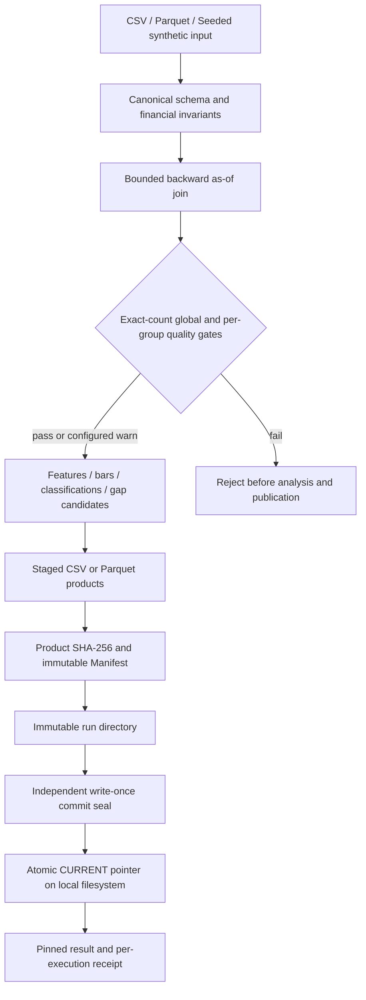

# MarketStream Engine v1.3

**A tested, local batch market-data processing engine with event-time joins, documented quality gates, versioned artifacts and independent commit seals.**

> **Portfolio-safe:** Uses seeded synthetic data by default. This is not an exchange gateway, production trading platform, exact monetary ledger, cryptographically authenticated archive, or a claim of financial performance. Confidential market files and proprietary assessment materials must not be published.

## Features and engineering improvements

1. **Independent commit seals:** new schema-4 immutable artifacts have write-once `commits/<artifact_id>.json` records. A damaged or externally modified Manifest cannot be re-trusted by simply republishing identical data. Legacy schema-3 artifacts remain readable under their weaker guarantees.
2. **Unrounded quality decisions:** rate thresholds compare exact counts using Decimal arithmetic; reports preserve the unrounded ratio and include symbol/trading-date breakdowns.
3. **Scoped quality gates and earlier rejection:** global and optional per-symbol/day policies run immediately after event-time alignment, before features, resampling and event detection. Quote-only products may instead use `warn` or disabled policies.
4. **External-data chart selection:** `figure_date: null` uses the latest trading date actually present for the selected symbol, not the synthetic `dates` configuration. Explicit `figure_date` is supported.
5. **Optional exact cumulative amount representation:** with `amount_minor_units_per_unit: 100`, accepted decimal inputs are converted to an int64 `cum_amount_minor` *before* float coercion, and carried into snapshot outputs. The separate float64 `cum_amount` remains analytical compatibility only. This is not a full Decimal price engine.
6. **Bounded integers and tick indexes:** count/quantity int64 overflow and unsafe float64 tick index sizes raise validation errors before narrowing casts.
7. **Documented canonical digest:** data fingerprints use the `canonical-rows-v1` codec (type-tagged, length-delimited, binary float representations) instead of pandas' internal hash implementation.
8. **Safer repository audit:** directory component checks case-fold names and detect nested risky folders, including `Data/` and `nested/SECRETS/`.

See [Chinese v1.3 report](docs/v1_3_hardening_CN.md), [architecture](docs/architecture.md), [data contract](docs/data_contract.md), [reliability](docs/reliability.md), [testing](docs/testing_and_benchmarks.md), and [ADR 010](docs/adr_010_v13_integrity.md).

## Architecture



## Installation & quick start

Python 3.11+ is recommended. Install from the repository root:

```bash
python -m venv .venv
source .venv/bin/activate     # Windows: .venv\Scripts\activate
python -m pip install -e ".[dev]"
marketstream validate
marketstream run --format parquet
marketstream current --output-dir outputs/demo --verify
pytest -q
```

`--format csv` works without PyArrow. `marketstream init --output myconfig.yaml` creates an editable config. From outside the repository, the default packaged config still works.

### Working with external, permitted files

Provide paired directories `data/private_demo/snapshots/*.csv` and `data/private_demo/trades/*.csv`, set `input_dir` in YAML, and set tick/amount units to match your source's contract. Never publish those private files or assume exchange rules are universal.

```yaml
input_dir: data/private_demo
output_dir: outputs/private
save_figure: true
figure_symbol: "000001"
figure_date: null     # latest actual day for this symbol
figure_missing: fail
amount_minor_units_per_unit: 100  # optional, only for feeds in 1/100 units
quality_gates:
  min_trade_match_rate: 0.95  # EXAMPLE THRESHOLD; depends on source quality
  per_symbol_day_min_match_rate: 0.90
  on_breach: fail
```

`amount_minor_units_per_unit` requires source values to have no fractional portion of a minor unit. It raises an error rather than rounding. If your feed has finer fractional increments, supply a different unit scale or leave this feature disabled.

## Versioned outputs and safe read

```text
outputs/demo/
├── CURRENT.json
├── .publish.lock
├── commits/<artifact_id>.json    # independent schema-4 Manifest seal
├── runs/<artifact_id>/
│   ├── snapshot_features.csv / .parquet
│   ├── interval_bars.csv / .parquet
│   ├── gap_candidates.csv / .parquet
│   ├── category_proportions.csv / .parquet
│   ├── liquidity_chart.png        # if requested and available
│   └── run_manifest.json
└── executions/<execution_id>.json
```

```python
from marketstream.storage.writers import open_published_artifact
artifact = open_published_artifact("outputs/demo", verify=True)
print(artifact.artifact_id, artifact.manifest["run_id"])
features_path = artifact.product_path("snapshot_features.parquet")
```

Pin the artifact once. `CURRENT` may advance while another writer publishes. `open_published_artifact(verify=True)` checks the pointer, independent commit seal and product hashes for schema-4 outputs. It does **not** authenticate against a privileged attacker able to modify all files in the output root; no signatures, append-only trusted journal or remote durability are provided. A crash between run directory rename and seal creation can leave an incomplete orphan that needs operator inspection; the publisher does not silently adopt it. Old schema-3 assets retain earlier, weaker verification.

The roles remain distinct: `run_id` identifies analysis recipe/data input; `artifact_id` identifies materialized format/figure; `execution_id` is per invocation even on reuse. See reliability docs for idempotency and crash boundaries.

## Correctness and limits

- Snapshot keys are unique `(symbol, trading_date, event_time)`; CSV identifiers preserve leading zeros.
- Backward `merge_asof` uses no future trade within selected symbol/date; no exact exchange feed sequencing is inferred.
- The trade-match report contains counts, raw ratio, and groups. Thresholds are configurable source policy, not universal market standards.
- Optional `cum_amount_minor` is exact under configured unit/accepted input bounds; most calculated prices remain float64 and event detection uses tick-grid validation.
- This is **in-memory batch**, not streaming or distributed processing. Runtime and memory claims require independent repeated benchmarks, not simulated trading results.
- No automatic garbage collection, cross-host locks, out-of-order exchange event replay, or fully secure cryptographic audit chain.

## Synthetic visualization


*Illustrative synthetic data; quote-relative changes are not trading-strategy returns.*

## Local engineering checks

```bash
python -m pytest -q
python -m pytest --cov=marketstream --cov-report=term-missing
ruff check src tests benchmarks tools
mypy src/marketstream --follow-imports=silent
python benchmarks/benchmark_isolated.py --mode e2e --rows 10000 --repeats 3
python tools/check_public_repo.py  # requires a Git repository
```

GitHub CI and Docker workflows are provided but may not have been executed in a live GitHub environment. Verify all optional dependencies and external checks before marking them green. The local verification record is `docs/local_verification_v13.json`.

## Repository scope and provenance

This public portfolio edition contains the current v1.3 code, runnable seeded synthetic demo, tests and current-version technical documentation. Historical handoff reports and legacy notebooks are deliberately omitted to reduce repository noise and minimize disclosure risk. The project has an MIT license. The synthetic chart is an illustrative visualization, **not observed exchange performance**.

GitHub-hosted CI, secret scanning and Docker verification need to run on your own repository before claiming public-release checks passed.

